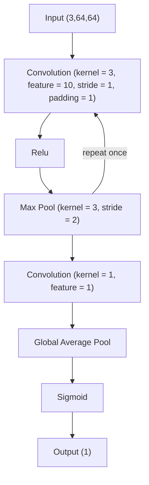

Detecting the presence of a cat in images, taken from [kaggle](https://kaggle.com/datasets/muhammeddalkran/catvnoncat), using a variety of neural network constructions.

The data comes as two sets, train and test. The test set is further stratified split (sklearn.model_selection.train_test_split) into two, the test and validate set. The true label count across the three sets are:
- Train: 72 / 209
- Validate: 16 / 25
- Test: 17 / 25

Different neural network models are constructed (torch.nn.Module) starting from the most simplistic (net_0) being a fully connected network with no hidden layer, to those that utilizes convolutional layers (net_2), and those that are described in literature (net_5) (Springenberg, 2014). A more complete description of each can be found in the starting section, in each within 'model'.

All constructions and its various hyperparameters are trained on the train set and validated on the validate set. Binary cross entropy loss and stochastic gradient descent are used, along with the same seed for weight randomization. The learn rates are searched in factors of 10. The performance of each, on the train and test sets, per epoch, is in 'result'. All are plotted and in 'plot', labeled with the format (model)\__(hyperparameter)__(learn rate)

For the train and validate set given, the baseline cross entropy (memorization of the train set probability without distinction on the validate set) is 
```math
-\left[
\frac{16}{25}\ln\left(\frac{72}{209}\right)
+
\frac{9}{25}\ln\left(\frac{137}{209}\right)
\right]
\approx 0.8,
```
as in any validation loss that is less than 0.8 will be considered to be better than guessing.

The performance of each construction and hyperparameter is evaluated on two criteria:
- Expected minimum loss: The average minimum loss across seed
- Minimum loss: The minimum loss across all seed

A few more variables are also collected:

- Number of parameter: The number of existing parameters
- Trainable parameter flag: A true / false flag for checking whether all parameters are trainable (torch.nn.Parameter.requires_grad == True)
- Number of multiply-accumulate operations (mac): As a measurement for the number of operations being computed per pass

The table of all variables are in 'selection/variable.csv'. Plots of the expected minimum loss and minimum loss versus the log of number of parameters and mac are in 'selection'.

For both expected minimum loss and minimum loss, the minimum and standard deviation is found. All constructions and hyperparameters that are within a standard deviation of the minimum are chosen (Hastie, 2001). Furthermore, on the number of parameters and mac, those that are within the ten least are found and saved in 'selection/chosen.csv'. 

The construction and hyperparameter with the most stability across epochs, per seed, are then chosen. Based on (Springenberg, 2014), table 1, it has the following structure



with the learn rate of 0.001, has 1201 parameters, and requires 1,973,071 mac per pass. The weights are kaiming uniform initialized and the biases start at zero (ApX Machine Learning, 2026).

Rather than using the seed that corresponds to the minimum loss, or averaging across all, a softmax normalization is used on the compliment of the loss, with the scaling parameter chosen so that seed with the minimum loss holds 30% of the weight (scipy.optimize.minimize). The result is

| Actual \ Predicted | Positive | Negative |
|---|---|---|
| Positive | 15 | 2 |
| Negative | 1 | 7 |

which gives a true positive rate of P( cat | positive ) = 0.9375 and a true negative rate of P( not cat | negative ) = 0.78. The accuracy is 0.88.

Reference

ApX Machine Learning (2026). Introduction to Neural Network. [Apxml](https://apxml.com/courses/introduction-to-neural-networks/chapter-5-building-first-neural-network/initializing-parameters)

Hastie, T., Tibshirani, R., & Friedman, J. (2001). The Elements of Statistical Learning: Data Mining, Inference, and Prediction.

Karpathy, A., Johnson, J., Yeung, S. (2016). CS231n: Convolutional Neural Networks for Visual Recognition. Stanford University Course Notes. [cs231](https://cs231n.github.io/convolutional-networks/).

Springenberg, J. T., et al (2014). Striving for simplicity: The all convolutional net. [arxiv](https://arxiv.org/abs/1412.6806).

Szegedy, Christian, et. al (2014). Going Deeper with Convolutions. [arxiv](https://arxiv.org/abs/1409.4842).

